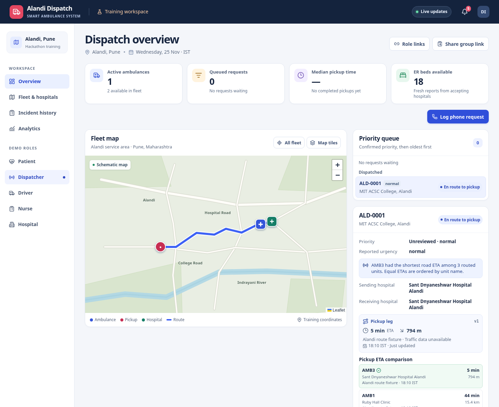
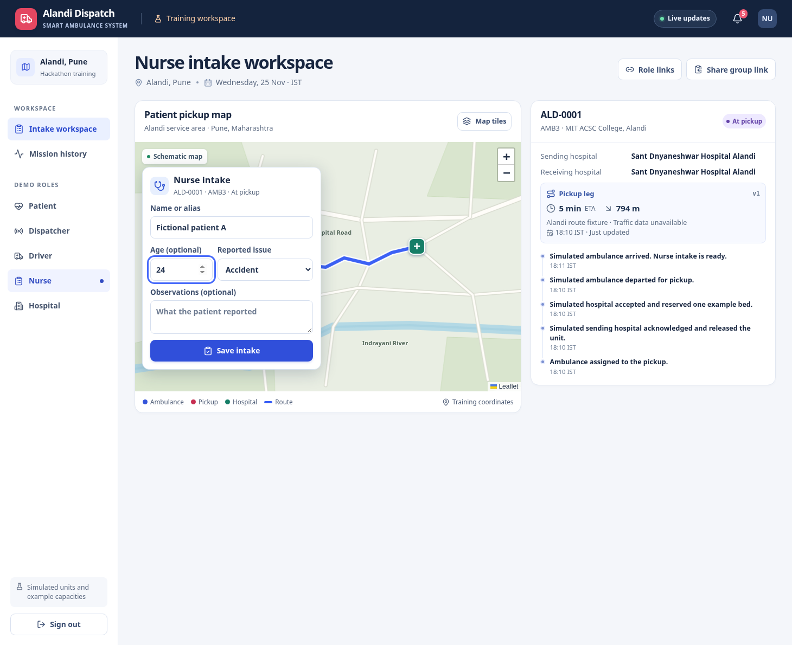

# Smart Ambulance Dispatch System

Alandi Dispatch is Amit Suresh Kadam’s college hackathon application for Alandi, Pune, Maharashtra. The public demo creates an isolated **Training workspace** with fictional people, simulated ambulances and example hospital capacities. Its SOS and hospital actions stay inside that group.



## Run it on Windows

Install Git and Docker Desktop with Docker Compose. Open PowerShell in the clone. Replace the Git URL and local folder with your repository location.

```powershell
$repo = Read-Host 'Git URL of the Smart Ambulance Dispatch repository'
git clone $repo smart-ambulance-dispatch
Set-Location .\smart-ambulance-dispatch
Copy-Item .env.example .env
docker compose up --build -d
docker compose ps -a
Invoke-RestMethod http://localhost:3000/api/health
Start-Process http://localhost:3000
```

The browser URL is **http://localhost:3000**. FastAPI’s interactive contracts are at **http://localhost:3000/api/docs**. Health returns `status: ok`, `database: true`, `redis: true` and `mode: demo`. Compose runs PostgreSQL, Redis, a one-time migration and seed job, the ASGI API, and an Nginx service serving the built React app with the API and WebSocket proxy.

```powershell
docker compose logs -f migrate api web
docker compose down
```

`docker compose up --build -d` incorporates edits into the built containers. The `pgdata` volume keeps development data when Compose stops. In the application, **Training controls → Reset group → Confirm reset** clears only the current training group. The group’s role links keep working.

### Two-terminal setup with live frontend edits

From the clone root, start only the data services. If using hosted databases instead, set `DATABASE_URL`, `MIGRATION_DATABASE_URL` if needed, `REDIS_URL` and a unique `REDIS_NAMESPACE` in `.env`. Use a separate development database and Redis namespace. Stop the Compose web service before starting Vite on port 3000.

```powershell
docker compose up -d db redis
notepad .\.env
```

**Terminal 1** from the repo root. Use Python 3.12 and run the virtual environment’s executable directly, which works without changing PowerShell’s execution policy.

```powershell
Set-Location .\backend
py -3.12 -m venv .venv
.\.venv\Scripts\python.exe -m pip install -r requirements.txt
.\.venv\Scripts\python.exe -m alembic upgrade head
.\.venv\Scripts\python.exe -m dispatch.manage seed-demo
.\.venv\Scripts\python.exe -m uvicorn app:app --host 127.0.0.1 --port 8010 --reload --no-access-log
```

**Terminal 2** from the repo root. Use Node 24 LTS. Vite forwards `/api` and the Socket.IO WebSocket upgrade, including the `/api` prefix, to port 8010.

```powershell
Set-Location .\frontend
npm ci
npm run dev
```

Check the two entry points from a third terminal or the browser.

```powershell
Invoke-RestMethod http://localhost:8010/api/health
Invoke-RestMethod http://localhost:3000/api/health
Start-Process http://localhost:3000
```

| Tool | Version exercised on Linux |
| --- | --- |
| Node / npm | 24.22.3 / 11.19.1 |
| Python / uv / Alembic | 3.12.14 / 0.13.9 / 1.18.4 |
| PostgreSQL / Redis | 17.8 / 7.4.8 |
| Docker / Compose / Nginx | 29.9.2 / 2.40.3 / 1.29.5 |
| Vite / Playwright / Chromium | 7.3.1 / 1.61.1 / 156.0.8078.79 |

The Windows commands use the same Node and Python versions and dependency locks. They were written for PowerShell and exercised through the equivalent commands on Linux.

## Five role views

Click **Start training demo** and share the resulting group link. For two independent sessions, open **Patient** in a normal browser window. Paste the same group link into an Edge InPrivate or Chrome Incognito window and open **Dispatcher**, **Driver**, **Nurse**, and **Hospital** from that group page. Multiple tabs also work. Each sign-in has its own tab session and refresh cookie. Hold Ctrl while clicking role links or use the open-in-new-tab control on the group page.

| Role | Judge actions |
| --- | --- |
| Patient | Pick the college, browser location, or a draggable or keyboard-editable pin. Confirm and send a training SOS. See your own queue position, unit, route estimate and timeline. |
| Dispatcher | Open a case in the queue, compare units and exclusions, log phone requests, confirm priority, assign a unit, inspect capacities and recover routing or destination failures. **Analytics** shows observed and forecast demand. |
| Driver | Follow the active road leg, confirm departure or arrival and see personal mission history. Connected drivers explicitly start foreground GPS tracking and can use the manual milestone controls if GPS is unavailable. |
| Nurse | Open the assigned mission at pickup, including after signing in late. Enter a fictional alias, optional age, reported issue and optional observations. A failed save keeps the form and retries with the same key. |
| Hospital | See **Incoming patients**, **Outgoing missions** and units owned by that hospital. Report capacity, accept or decline an incoming destination, and confirm handover at arrival. In connected mode the sending hospital also acknowledges and releases its unit. |

The main Driver and Nurse links are for AMB3. The group page has links for AMB1 and AMB2 staff and all three hospitals.

### Three-minute judge walkthrough

| Time | Demonstration |
| --- | --- |
| 0:00–0:35 | Start a training group. Open Patient in one browser and Dispatcher and Driver in the other. In Patient choose **Alandi demo pickup → Confirm pickup pin → Send training SOS**. |
| 0:35–1:05 | Show **ALD-0001** in the dispatcher’s selected case. AMB3 has a 5-minute pickup from Sant Dnyaneshwar Hospital Alandi, versus 44 minutes for AMB1 and 49 minutes for AMB2. The driver sees the pickup road leg. The simulation accelerates travel and releases AMB3 automatically. |
| 1:05–1:40 | Open Nurse from the same group after the mission reaches **At pickup**. Use `Demo patient A` and `accident`, then choose **Save intake** once. The tablet closes and the driver sees **Receiving leg** and **Transporting**. |
| 1:40–2:20 | Open Hospital, select the incoming ALD-0001 and choose **Confirm handover** once it reaches **At hospital**. Point out the completed timeline, the occupied bed and AMB3’s availability. |
| 2:20–3:00 | Show Analytics and its model and baseline errors. In a fresh group, try **Inject traffic** while a leg is active or mark AMB3 offline before the SOS to show AMB1 win. |

To demonstrate a waiting request, mark AMB1 and AMB2 offline under **Fleet & hospitals → Update unit** before the first SOS. While AMB3 is busy, use **Log phone request** to add a second case. After handover, the queue releases the highest-priority waiting case to AMB3.



## Dispatch, capacity and routing

- Patient urgency is recorded as reported. Queue order uses dispatcher-confirmed critical, high and normal priority, then request time, then case code. An unreviewed request has normal queue priority. Staff set equipment or receiving service requirements.
- Demo units dispatch from checked-in fixture hospital bases. Connected mobile units use their latest valid GPS fix, or a checked-in base when there is no GPS fix. Busy, offline, out-of-service, stale or unsuitable units are excluded. Among routes returned successfully, the lowest arrival ETA wins. The unit name breaks ties. The dispatcher sees candidates without usable estimates and can retry or provide a reasoned manual estimate.
- The sending hospital owns its unit. A full ER can release an ambulance. The example accepting sending hospital gets first preference in the demo if it meets the case requirements. Connected destinations are ranked by road ETA once accepting status, capacity freshness and service fit are proven. Hospital code breaks ties. Acceptance reserves a bed, cancellation or destination change releases it, and handover converts it to occupied.
- A hospital may decline before transport starts. While there is no accepted destination, intake can be saved and the mission stays at pickup for coordination. In connected mode the driver confirms departure once intake and acceptance are present. Dispatchers can replace an assignment before departure in one transaction. Patients can cancel their own queued or assigned request while it is still awaiting departure. Dispatchers can also cancel before arrival at the pickup.
- The demo stores simulation leg start time, duration and geometry in PostgreSQL. A browser asks the server to catch up when the group is open. A reopened group can apply overdue steps once. The demonstration uses the Alandi hospital fixture `18.6731, 73.8984` and college fixture `18.67160, 73.89140`. The schematic, coordinates, unit names, capacities and route times are example data.
- With a server-side TomTom key in connected mode, the API sends only coordinates and routing options with traffic and departure time set to now. Recalculation compares alternatives to the remaining time on the current road leg. It uses a 45-second default improvement threshold and a 30-second cooldown. A failed provider response retains the timestamped last-known route where available. The demo starts on the bundled schematic. **Map tiles** requests the configured provider and a failure leaves the route, markers and controls usable.

Timestamps persist in PostgreSQL as UTC instants and render in Asia/Kolkata. The dashboard median uses persisted request and pickup-arrival time. A new group shows an empty state until an arrival is stored.

## Demand model

`backend/ml/train.py` generates request timestamps in three zones using seed `241125` and aggregates every zone-hour bucket in Asia/Kolkata, including empty hours. The Poisson model uses zone, hour and weekday. Training uses the first ten weeks starting 6 January 2025. The following two weeks form the holdout. The baseline is the historical mean for each zone and hour of day fitted on the training period. The forecast compares expected requests next hour with stored workspace requests in the last completed hour. Ambulance assignment uses the dispatch rules above.

```powershell
Set-Location .\backend
.\.venv\Scripts\python.exe -m ml.train
```

```text
alandi-poisson-1 · seed 241125 · 4687 synthetic incidents
5040 training rows · 1008 later holdout rows · 3103 zero-count rows
Poisson MAE 0.665060 · historical-average MAE 0.712925
```

`backend/ml/model.json` is the precomputed artifact. The dashboard labels it **trained on synthetic data**. The app runs without an LLM or TomTom key in training mode.

## Paths to edit

All source and configuration files are plain text. In Notepad, open the existing file or use **Save as → All files → UTF-8** to preserve its extension. Use `notepad .\frontend\src\features\Dispatcher.tsx` from the root, for example.

| Path from repo root | Purpose |
| --- | --- |
| `frontend\src\features\` | Patient, dispatcher, hospital, driver and nurse views |
| `frontend\src\components\Map.tsx` | Leaflet layers, schematic and map tile fallback |
| `frontend\src\lib\session.tsx`, `frontend\src\lib\live.ts` | Tab sessions and durable live reconciliation |
| `backend\app.py` | Importable FastAPI and Socket.IO ASGI app |
| `backend\dispatch\`, `backend\migrations\versions\` | Domain logic, storage and DB revisions |
| `backend\fixtures\alandi.py`, `backend\ml\` | Demo geometry, hospital and fleet fixtures, model and training |
| `backend\tests\`, `frontend\e2e\` | API, domain, PostgreSQL/Redis integration and browser tests |
| `docker-compose.yml`, `vercel.json`, `.env.example` | Local services, public routing and configurable settings |

## Tests and deployment

The test commands, recorded results and remaining account steps are in [Verification](docs/VERIFICATION.md). [Deployment](DEPLOYMENT.md) covers Vercel Services, Preview and Production, Neon, native Upstash Redis, and PowerShell. [API and connected operation](docs/API.md) covers the role matrix, Socket.IO, and a scoped capacity feed sample. This project is licensed under the [MIT License](LICENSE).
